<div align="center">

```
   _____ ____  __  ________________  ________       _______  ______  ___       ____  ____  _____
  / ___// __ \/ / / /  _/ __ \  __ \/ ____/ /      / ____\ \/ / __ )/   |     / __ \/ __ \/ ___/
  \__ \/ / / / / / // // /_/ / /_/ / __/ / /      / /     \  / __  / /| |    / / / / /_/ /\__ \ 
 ___/ / /_/ / /_/ // // _, _/ _, _/ /___/ /___   / /___   / / /_/ / ___ |   / /_/ / ____/___/ / 
/____/\___\_\____/___/_/ |_/_/ |_/_____/_____/   \____/  /_/_____/_/  |_|   \____/_/    /____/  
```

# 🐿️ SQUIRREL CYBER OPS
### 💜 PURPLE TEAM CYBERSECURITY PORTFOLIO // UNIKL MIIT EDITION 💜

[](https://nnhazirah.github.io/MS-SQUIRREL/)
[](https://www.unikl.edu.my)
[](https://github.com/Nnhazirah)
[](https://github.com/Nnhazirah)

---

### 📡 `[SYSTEM STATUS: DEFCON PURPLE // ACTIVE MONITORING // AGENT ACORN ONLINE]`
*Connecting Adversarial Red Team Emulation with Resilient Blue Team Detection Engineering*

[🗂️ Operative Dossier](#-1-operative-dossier--student-profile) • [🟣 Purple Philosophy](#-2-purple-team-cybersecurity-identity) • [⚡ Combat Simulator](#-3-interactive-purple-team-combat-simulator) • [🛠️ Technical Arsenal](#-4-technical-arsenal--skills-matrix) • [📂 Projects](#-5-projects--laboratory-journey) • [📡 Uplink](#-6-secure-transceiver--contact)

---

</div>

## 👤 1. Operative Dossier & Student Profile

```
┌────────────────────────────────────────────────────────────────────────────────────────┐
│ IDENTIFICATION MATRIX // UNIKL MIIT CYBER DEFENSE DIRECTIVE                            │
├─────────────────────┬──────────────────────────────────────────────────────────────────┤
│ Full Name           │ Nik Nurhazirah binti Nik Hussain                                 │
│ Student ID          │ 52215226033                                                      │
│ Callsign / Mascot   │ Agent Acorn // Purple Squirrel Operative 🐿️                      │
│ Degree Programme    │ Bachelor of Information Technology (Hons) in Cyber Security      │
│ Institution         │ Malaysian Institute of Information Technology (MIIT), UniKL      │
│ Primary Campus      │ UniKL City Campus, 1016 Jalan Sultan Ismail, 50250 Kuala Lumpur │
│ Operating Systems   │ Kali Linux 2026.x (Offensive) | Debian / Windows Server (Defense)│
│ Operational Focus   │ Vulnerability Assessment, Threat Hunting, Behavioral EDR Sensor  │
└─────────────────────┴──────────────────────────────────────────────────────────────────┘
```

### 📖 About Me // The Cyberpunk Journey
I am an aspiring **Purple Team Cybersecurity Specialist** currently pursuing my undergraduate degree at **Universiti Kuala Lumpur (UniKL)**. My technical mission is focused on closing the critical gap between offensive penetration testing and defensive security monitoring. 

Rather than treating Red and Blue teams as isolated silos, I utilize empirical offensive telemetry (such as port scan bursts, brute-force attempts, and container breakouts) to design, validate, and fine-tune high-fidelity detection rules that stop cyber adversaries before data exfiltration occurs.

> 🎯 **Career Horizon:** Aspiring Purple Team Lead • SOC Detection Engineer • Behavioral Malware Analyst • Offensive Security Auditor

---

## 🟣 2. Purple Team Cybersecurity Identity

```mermaid
flowchart LR
    subgraph RED["🔴 RED TEAM (Offensive)"]
        R1["Reconnaissance & OSINT"]
        R2["Port Probing & Service Enumeration"]
        R3["Credential Brute-Force (Hydra)"]
        R4["Privilege Escalation (Docker Escape)"]
    end

    subgraph PURPLE["🟣 PURPLE TEAM (The Catalyst)"]
        P1["Collaborative Emulation Drills"]
        P2["Empirical Telemetry Ingestion"]
        P3["Detection Rule Validation"]
        P4["Zero-Blindspot Architecture"]
    end

    subgraph BLUE["🔵 BLUE TEAM (Defensive)"]
        B1["Firewall ACL & Rate-Limiting"]
        B2["SIEM Correlation & Logging"]
        B3["Fail2ban & Automated Jails"]
        B4["Behavioral EDR (XGBoost / ML)"]
    end

    RED -->|"Offensive Telemetry"| PURPLE
    PURPLE -->|"Optimized Rules"| BLUE
    BLUE -->|"Defensive Feedback"| PURPLE
    PURPLE -->|"Targeted Re-Test"| RED
```



### ⚔️ The Triad Dynamics:
* **🔴 Red Team (Adversary Emulation):** Tests real-world resilience through reconnaissance, stealth SYN port scanning, directory fuzzing, and Sudo command execution.
* **🔵 Blue Team (Detection & Containment):** Deploys automated firewall dropping, HIDS sensor log correlation, Fail2ban jails, and behavioral machine-learning algorithms.
* **🟣 Purple Team (The Bridge):** Synthesizes both worlds into an agile feedback loop—turning every red exploit proof-of-concept into a permanent blue detection signature.

---

## ⚡ 3. Interactive Purple Team Combat Simulator

<details open>
<summary><b>▶️ SCENARIO 1: Stealth TCP SYN Port Scan (Nmap Half-Open Sweep)</b></summary>
<br>

```text
[🔴 RED TEAM ATTACK]
$ sudo nmap -sS -p 1-65535 -T4 --reason 192.168.100.117
Attacker (192.168.100.128) sends 65,535 raw TCP SYN packets without completing the 3-way handshake.

[🔵 BLUE TEAM DETECTION]
Suricata HIDS flags anomaly: "ET SCAN Potential Nmap SYN Scan burst (>5,000 half-open connections/sec)".
Stateful firewall detects missing ACK packets and begins dropping half-open state table allocations.

[🟣 PURPLE TEAM MITIGATION & RULE]
Action: Dynamic iptables rate-limiting applied. Rule committed to edge firewall:
iptables -A INPUT -p tcp --syn -m limit --limit 50/s --limit-burst 100 -j ACCEPT
iptables -A INPUT -p tcp --syn -j DROP
```
</details>

<details>
<summary><b>▶️ SCENARIO 2: SSH Credential Brute-Force (THC-Hydra Dictionary Assault)</b></summary>
<br>

```text
[🔴 RED TEAM ATTACK]
$ hydra -l robin -P p_lists.txt ssh://192.168.100.117 -t 4 -V
Attacker initiates automated dictionary password spraying targeting account 'robin' using 325 mutations.

[🔵 BLUE TEAM DETECTION]
OpenSSH daemon triggers 5 auth failures within 8 seconds on port 22:
sshd[1842]: Failed password for robin from 192.168.100.128 port 39420 ssh2

[🟣 PURPLE TEAM MITIGATION & RULE]
Action: Fail2ban immediately isolates the attacking IP for 3600 seconds.
Permanent Hardening: Disabled password-based SSH authentication in /etc/ssh/sshd_config:
PasswordAuthentication no
PubkeyAuthentication yes
```
</details>

<details>
<summary><b>▶️ SCENARIO 3: Container Breakout & Sudo Privilege Escalation</b></summary>
<br>

```text
[🔴 RED TEAM ATTACK]
$ sudo -u jerry /home/robin/project/feedback.sh  --> /bin/bash (Shell Hijack)
$ docker run -v /:/mnt --rm -it alpine chroot /mnt sh  --> Root Flag Exfiltration

[🔵 BLUE TEAM DETECTION]
Auditd / Sysmon flags execution of /bin/sh with UID 0 originating from an ephemeral Alpine container mounting '/'.

[🟣 PURPLE TEAM MITIGATION & RULE]
Action: Principle of Least Privilege enforced. Removed user 'jerry' from local docker group:
sudo gpasswd -d jerry docker
Enabled rootless Docker daemon mode and activated AppArmor container confinement profile.
```
</details>

<details>
<summary><b>▶️ SCENARIO 4: Behavioral Ransomware Burst Encryption</b></summary>
<br>

```text
[🔴 RED TEAM ATTACK]
Adversary executes rapid cryptographic locker modifying 50 user documents in under 5 seconds.

[🔵 BLUE TEAM DETECTION]
UniKL ML Behavioral Sensor (XGBoost) flags burst activity: High write velocity + Shannon entropy > 7.85.
Classification confidence: 99.8%. Host network adapter isolated in 350ms before volume shadow copy deletion.

[🟣 PURPLE TEAM MITIGATION & RULE]
Action: Machine learning feature weights updated. 3-2-1 immutable cloud backup restoration pipeline validated.
```
</details>

---

## 🛠️ 4. Technical Arsenal & Skills Matrix

```
┌────────────────────────────────────────────────────────────────────────────────────────┐
│ CAPABILITY RADAR                                                PROFICIENCY RATING     │
├───────────────────────────────────────────────────────────────┬────────────────────────┤
│ Vulnerability Assessment (Nmap 7.94, Nikto v2.5, Gobuster v3.6)│ ███████████████████░ 95% │
│ OSINT & Passive Reconnaissance (theHarvester, WHOIS, Wayback) │ ██████████████████░░ 90% │
│ Linux Systems Administration & Hardening (Kali / Debian / Bash)│ ██████████████████░░ 92% │
│ Python Security Scripting & Automated Pipelines               │ ██████████████████░░ 90% │
│ Endpoint Security & Behavioral ML Defense (Random Forest/XGB)  │ ███████████████████░ 94% │
│ Protocol Authentication Cracking (THC-Hydra, Leetspeak Dictionaries)█████████████████░░░ 88% │
│ TCP/IP Network Packet Analysis & Protocol Sniffing (Wireshark) │ ██████████████████░░ 91% │
│ SIEM Alert Correlation & Detection Engineering (Snort/Sysmon)  │ █████████████████░░░ 86% │
└───────────────────────────────────────────────────────────────┴────────────────────────┘
```

---

## 💻 5. Simulated Command Line Interface (CLI)

```bash
nikira@squirrel-ops:~$ whoami
Nik Nurhazirah binti Nik Hussain (Student ID: 52215226033)

nikira@squirrel-ops:~$ cat /etc/motd
================================================================================
  ____   ___  _   _ ___ ____  ____  _____ _       ______   ______  _____ ____  
 / ___| / _ \| | | |_ _|  _ \|  _ \| ____| |     / ___\ \ / / __ )| ____|  _ \ 
 \___ \| | | | | | || || |_) | |_) |  _| | |    | |    \ V /|  _ \|  _| | |_) |
  ___) | |_| | |_| || ||  _ <|  _ <| |___| |___ | |___  | | | |_) | |___|  _ < 
 |____/ \__\_\\___/|___|_| \_\_| \_\_____|_____| \____| |_| |____/|_____|_| \_\
                  PURPLE TEAM EDITION // AGENT ACORN v2.6.4                    
================================================================================
[+] System Online: UniKL MIIT Cyber Defense Range
[+] Status: DEFCON PURPLE // Zero Security Blindspots Detected

nikira@squirrel-ops:~$ cat /home/nikira/flags.txt
🚩 Flag 1 (User Robin) : Fl4g{u5er1r34ch3d5ucc355fully}
🚩 Flag 2 (User Jerry) : Fl4g{Y0ur34ch3du53r25uc355ful1y}
🚩 Flag 3 (System Root): Fl4g{r00t_pr1v1l3g3_3sc4l4t10n_d0ck3r_m4st3r}
```

---

## 📂 6. Projects & Laboratory Journey

| Project Title | Core Focus | Architecture & Stack | Repository Link |
| :--- | :--- | :--- | :---: |
| **Vulnerability Analysis Suite** | Lab 1 to Lab 4 Penetration Testing Lifecycle | Threat vs Vuln, VulnHub BlueMoon CTF, Passive OSINT, Active Footprinting | [**Inspect Repo ↗**](https://github.com/Nnhazirah/Vulnerability-Analysis) |
| **Behavioral Ransomware Defense** | ML Sliding-Window Feature Extractor & Containment | Python, XGBoost, Random Forest, Shannon Entropy, CustomTkinter | [**Inspect Repo ↗**](https://github.com/Nnhazirah/IDB30102_GroupI_EndpointSecurity) |
| **BlueMoon 2021 CTF Walkthrough** | Boot2Root Target Compromise & Privilege Escalation | Gobuster, zbarimg, Hydra, Sudo Injection, Docker Breakout | [**View Walkthrough ↗**](https://github.com/Nnhazirah/Vulnerability-Analysis/blob/main/Bluemoon.md) |
| **Squirrel Recon Automation** | Passive OSINT Intelligence Pipeline | Python 3, crt.sh API, DNSDumpster, Wayback CDX | Academic Research |

---

## 📡 7. Secure Transceiver & Contact

<div align="center">

```
┌────────────────────────────────────────────────────────────────────────┐
│                        UPLINK DIRECTORY                                │
├─────────────────┬──────────────────────────────────────────────────────┤
│ 👤 Operative    │ Nik Nurhazirah binti Nik Hussain                     │
│ 🆔 Student ID   │ 52215226033                                          │
│ 🏫 Institution  │ Universiti Kuala Lumpur (UniKL MIIT)                 │
│ ✉️ Direct Email │ hazirahhussain04@gmail.com                           │
│ 🐙 GitHub Hub   │ https://github.com/Nnhazirah                         │
│ 🌐 Live Webpage │ https://nnhazirah.github.io/MS-SQUIRREL/             │
└─────────────────┴──────────────────────────────────────────────────────┘
```

**[⬆️ Return to Command Top](#️-squirrel-cyber-ops)**

---

*All simulations, scans, and exploitation proof-of-concepts documented in this portfolio were conducted inside an authorized, isolated virtual hypervisor laboratory environment at UniKL MIIT in strict adherence to cybersecurity academic ethics.*

</div>
