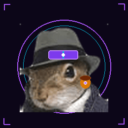

<div align="center">

<!-- AESTHETIC CYBERPUNK HEADER BANNER -->


<!-- ANIMATED TYPING HEADER -->
<a href="https://github.com/Nnhazirah">
  
</a>

<p align="center">
  
  
  
  
</p>

---

<!-- SQUIRREL CYBER MASCOT & QUICK BIO -->
<table>
  <tr>
    <td width="38%" align="center">
      
      <br><br>
      <sub><b>🐿️ AGENT ACORN // PURPLE SQUIRREL</b></sub>
    </td>
    <td width="62%">
      <h3>👋 Welcome to My Cyber Space!</h3>
      <p>
        I'm <b>Nik Nurhazirah binti Nik Hussain</b>, a Cyber Security undergraduate at <b>Universiti Kuala Lumpur (UniKL MIIT)</b> with a passion for <b>Purple Team operations</b>.
      </p>
      <p>
        I love exploring how adversaries think (<b>Red Team</b>) and using that offensive telemetry to build resilient, automated defenses (<b>Blue Team</b>).
      </p>
      <ul>
        <li>🎓 <b>Degree:</b> Bachelor of Information Technology (Hons) in Cyber Security</li>
        <li>🆔 <b>Student ID:</b> <code>52215226033</code></li>
        <li>📍 <b>Location:</b> Kuala Lumpur, Malaysia 🇲🇾</li>
        <li>💜 <b>Current Focus:</b> Vulnerability Assessment, OSINT & Endpoint Security</li>
        <li>🌱 <b>Learning:</b> Purple Teaming, Threat Hunting & Malware Analysis</li>
      </ul>
    </td>
  </tr>
</table>

---

### 🛠️ Technical Arsenal & Skills

<p align="center">
  
</p>

```
┌────────────────────────────────────────────────────────────────────────┐
│ 💜 CAPABILITY MATRIX:                                                  │
├────────────────────────────────────────────────────────────────────────┤
│ 🔍 Vulnerability Assessment & Port Probing (Nmap, Nikto, Gobuster)     │
│ 🕵️ OSINT & Passive Reconnaissance (theHarvester, WHOIS, Search Dorks) │
│ 🛡️ Threat Hunting & Detection Engineering (Firewalls, SIEM, Sysmon)   │
│ 💻 Linux System Hardening & Bash Automation (Debian / Kali)            │
│ 🐍 Python Scripting for Security Tools & Network Packet Analysis       │
└────────────────────────────────────────────────────────────────────────┘
```

---

### 🌐 Cyber Command Highlights

<div align="center">

| Operational Vector | Domain & Tools | Objective & Directive |
| :---: | :---: | :--- |
| **🔴 Red Team (Offensive)** | `Nmap`, `Gobuster`, `Hydra` | Adversary Emulation, SYN Sweeps, Authentication Cracking |
| **🔵 Blue Team (Defensive)** | `Sysmon`, `Firewalls`, `EDR` | Threat Detection, Behavioral Analysis, Automated Containment |
| **🟣 Purple Team (Bridge)** | `Telemetry`, `Rule Engineering` | Collaborative Exercises, Closing Security Blindspots |

</div>

---

### 💬 Let's Connect!

<p align="center">
  <a href="mailto:hazirahhussain04@gmail.com">
    
  </a>
  &nbsp;
  <a href="https://github.com/Nnhazirah">
    
  </a>
  &nbsp;
  <a href="https://www.unikl.edu.my">
    
  </a>
</p>

<br>

<p align="center">
  <i>"Think like a Red Teamer. Defend like a Blue Teamer. Connect both worlds like a Purple Teamer."</i> 🐿️💜
</p>

<!-- WAVE FOOTER -->


</div>
